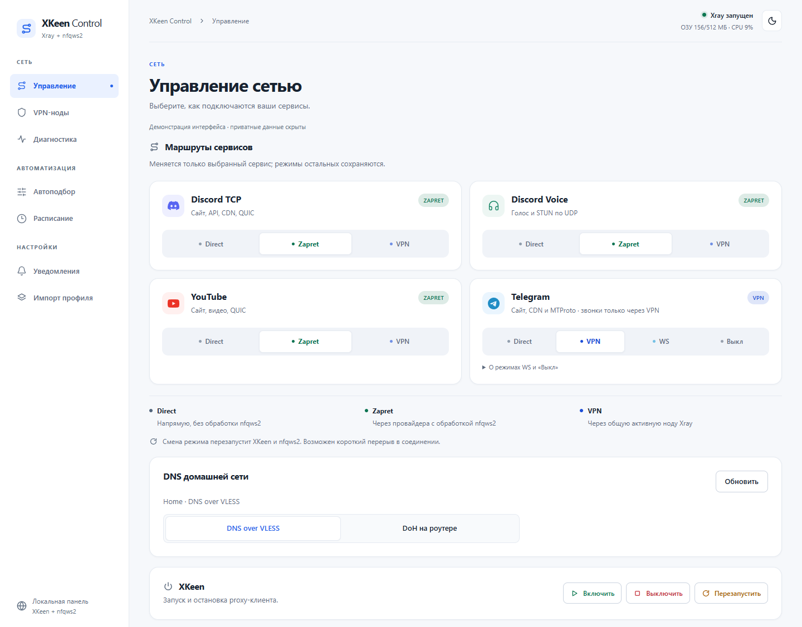
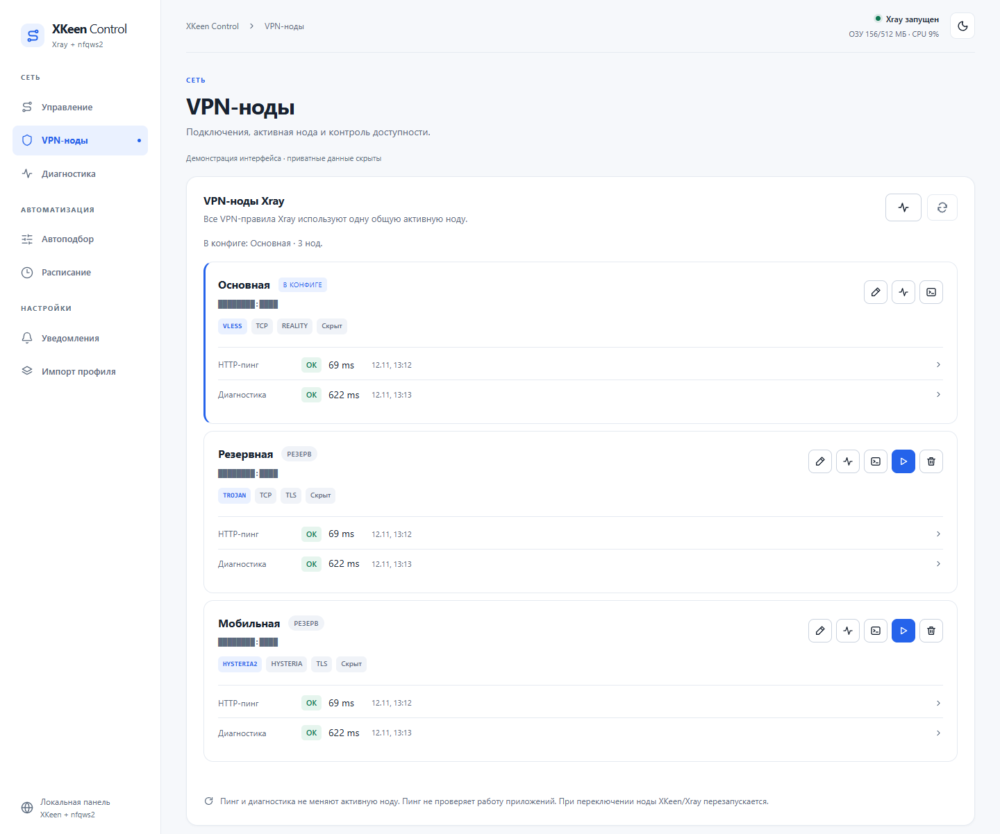
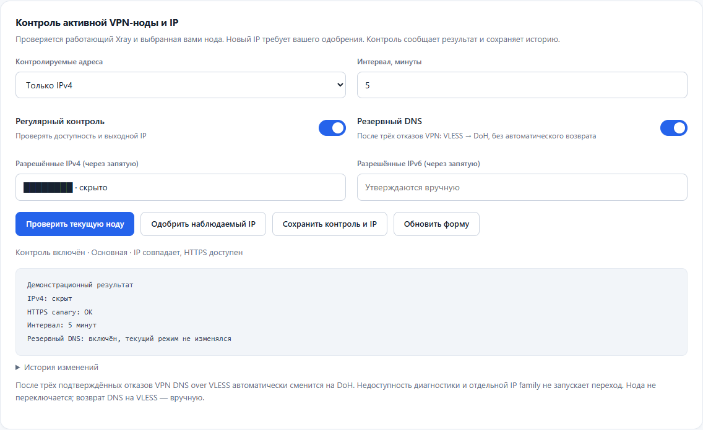
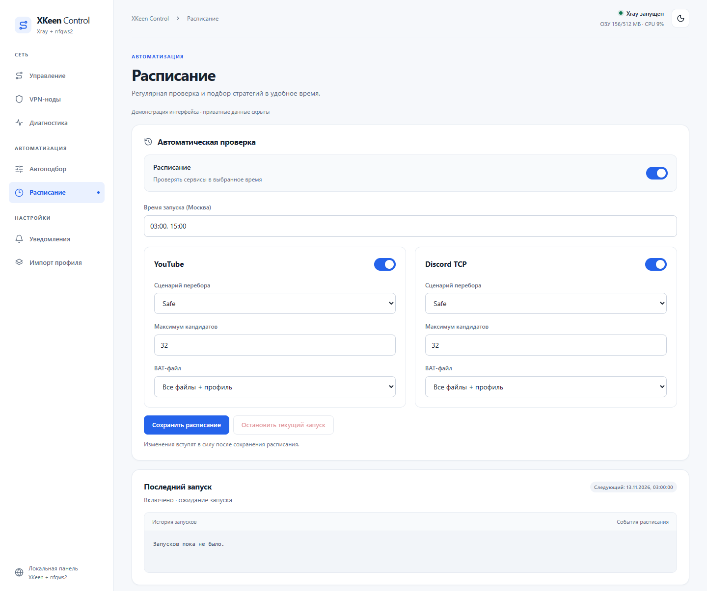
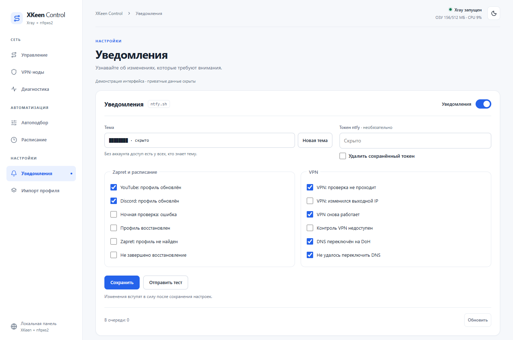

# XKeen + nfqws2: управление маршрутами и VPN

Панель управления Discord, YouTube, Telegram, VPN-нодами и DNS на Keenetic.
Версия движка: `SCRIPT_VERSION=3.2.0`.

## Интерфейс

Скриншоты с демонстрационными данными. Приватные адреса и параметры скрыты.



<details>
<summary>VPN-ноды, резервный DNS, расписание и уведомления</summary>









</details>

## Требования

- Keenetic с Entware, Python 3.12+ и nfqws2.
- **XKeen 2.1+ поколения 2.x**, только Xray. Версии 2.0, unknown и major3
  отклоняются. Новая установка без XKeen, standalone и Mihomo не поддерживаются.
- Для управления VPN-нодами и новых чекеров: Xray 26.10.31+ поколения 26.
- Для проверки маршрута, ресурсов и контроля IP: `curl` с HTTP2 и отдельно
  подготовленный loopback-доступ к Xray API/SOCKS.
- Полный пакет проекта, а не один скопированный shell-файл.
- Для рабочих операций — доступный RCI-токен и корректные policy marks
  при `pbr_strict=on`. Подробности: [безопасность движка](docs/reference/safety.md).

## Что можно настроить

| Сервис | Режимы |
|---|---|
| Discord TCP: сайт, API, CDN, QUIC | Direct / Zapret / VPN |
| Discord Voice: голос и STUN по UDP | Direct / Zapret / VPN |
| YouTube: сайт, видео, QUIC | Direct / Zapret / VPN |
| Telegram | Direct / VPN / WS / Выкл |

Основная схема — Direct по умолчанию через завершающее правило обычных
transparent-входов; VPN применяется по выбранным правилам. Пользовательские
исключения, блокировки и отдельные пути DNS/SOCKS сохраняются.

В управляемом режиме Direct профиль nfqws2 этого сервиса выключен;
в Zapret он включён. Отдельная диагностическая проба Direct идёт через
Freedom и может обрабатываться текущим nfqws2 и политиками Keenetic.
VPN использует **одну общую активную ноду**, а не отдельный VPN для каждого
сервиса. Панель принимает VLESS, Trojan, Hysteria2 и JSON outbound.
Импорт WireGuard экспериментальный: приём ссылки/JSON не подтверждает
работоспособность протокола в установленном Xray. Подробнее: [VPN-ноды](docs/configuration/vpn.md).
У Telegram «Выкл» означает unmanaged: правила проекта не добавляются.

Xray остаётся включённым и для управляемого Direct/Zapret: он участвует
в маршрутизации. Остановка XKeen не является переключением сервиса в Direct.

## Панель

После отдельной установки: `http://192.168.2.1:8088` из доверенной LAN.

- Управление: маршруты четырёх сервисов и просмотр профилей.
- VPN-ноды: добавить/изменить ноду, проверить отдельной кнопкой, сделать активной.
- Вверху VPN-нод: иконки массового HTTP-пинга и обновления списка с подсказками.
- CPU и ОЗУ: обновление каждые 2 секунды в открытой вкладке. Быстрый статус
  показывает процесс Xray и записанные режимы; это не проверка соединения VPN.
- Контроль текущей ноды: IP/HTTPS каждые 5 минут по умолчанию, явное одобрение IP, уведомления и опциональный резервный DNS.
- Диагностика: состояние роутера; Standard/DPI — запросы из браузера.
- Маршрут Xray и контроль VPN/IP — [подготовка доступа и границы проверок](docs/usage/route-checker.md).
- Автоподбор: отдельные сценарии YouTube, Discord TCP и Voice.
- Расписание: YouTube и Discord TCP, например `05:00` или `03:00, 15:00`,
  время Europe/Moscow. Выключено до явного включения.
- Импорт: найденные профили, версии и откат.

Проверки отвечают на разные вопросы:

| Проверка | Что проверяет |
|---|---|
| «Пинг» / «Пинг всех нод» | Быстрый повторный HTTP HEAD через временный Xray; не ICMP и не проверка приложений |
| «Диагностика» у VPN-ноды | Подробная проверка двух HTTPS-сайтов и журнал ошибок |
| «Проверить маршрут» | Решение работающего Xray для заданных домена/IP, inbound и портов |
| «Проверить текущую ноду» и регулярный контроль | Выходной IP работающего VPN и небольшой HTTPS canary |
| Standard/DPI | Запросы из браузера по маршрутам компьютера |
| Автоподбор и его расписание | Проверку и выбор стратегий nfqws2 своим runner-ом |

Контроль VPN по умолчанию выключен. Сначала отдельно подготовьте доступ,
получите и явно одобрите IP текущей ноды, затем сохраните периодичность и
контролируемые IPv4/IPv6. По умолчанию интервал 5 минут. Монитор сообщает
изменения, но не балансирует ноды, не принимает новый IP и не перезапускает
службы. «Резервный DNS» отдельно разрешает переход с VLESS на DoH после
трёх подтверждённых отказов; недоступная диагностика его не запускает.
Возврат на VLESS — вручную, рестарт XKeen для смены DNS-профиля не нужен.
После внешнего рестарта Xray или ребута требуется повторная явная
подготовка доступа. Порядок действий: [чекеры и VPN/IP](docs/usage/route-checker.md).

Проверки браузера идут по маршрутам компьютера; собственный VPN/прокси
компьютера тоже влияет. CORS, timeout и HTTP4xx не доказывают DPI-блокировку.
Автоподбор и расписание используют одинаковые роутерные пробы; они не
гарантируют качество YouTube на телевизоре или голосового соединения.

Расписание обновляет BAT-источники перед проверкой, дважды проверяет текущий
профиль и только при неудаче запускает выбранный перебор. Найденный профиль
применяется с последующей проверкой и откатом при ошибке. nfqws2 может
перезапускаться, XKeen при таком подборе не перезапускается.
Смена маршрута или активной VPN-ноды — другие операции: они могут
перезапускать XKeen после нажатия пользователя.

Полная инструкция: [панель и расписание](tools/router/README.md).

## CLI

Команды выполняются из корня установленного проекта на роутере.
Сначала чтение, не применение:

```sh
sh apply-discord-nfqws2.sh --help
sh apply-discord-nfqws2.sh --status
sh apply-discord-nfqws2.sh --check-config
sh apply-discord-nfqws2.sh --show-snapshots
```

Изменение одного сервиса — только после проверки и явного решения:

```sh
sh set-service-route.sh youtube zapret --core auto --yes-router
sh set-service-route.sh discord-tcp vless --core auto --yes-router
```

Остальные сервисы сохраняют выбранные режимы. `vless` — имя
CLI-режима VPN; оно не ограничивает тип выбранной глобальной ноды.
WAN-параметры не угадывайте по старым примерам с `eth3`.
Все варианты: [режимы и флаги](docs/configuration/cli.md).

## Откат и хранение

`rollback-last-change.sh` восстанавливает последнее состояние перед полным
применением; `rollback-to-baseline.sh` — исходную точку, если она существует.
`--rollback-import` относится к последнему импорту профиля и не заменяет полный
откат. Перед записью движок проверяет совместимость всех выбранных снимков.

Снимки XKeen 2.0/без версии **не восстанавливаются**, даже частично.
Нужна точная версия XKeen, включая Stable/Beta; одного совпадения checksum
недостаточно. Ошибка с результатом `partial` требует ручной проверки.

После успешных операций очищаются снимки строго старше30 дней, но минимум
одна точка на хранилище остаётся. Baseline/latest и ссылки истории/корзины
защищены. История старше30 дней переносится в корзину ещё на30 дней.
Активные и последние версии профилей сохраняются. Отдельного cron очистки нет.

Подробнее: [эксплуатация](docs/usage/operations.md).

## Установка, обновление и перезагрузка

Shell-файлы в корне — рабочие лаунчеры Python. Не удаляйте их.
Сначала проверяют целевую версию, совместимость и резервную копию, затем
делают dry-run поставки. Само наличие нового кода не обновляет устройство.
Порядок установки и отката панели — [tools/router/README.md](tools/router/README.md).

После ребута дождитесь Entware и автозапуска служб, проверьте состояние и
доступность панели. Для ранее включённого контроля VPN заново подготовьте
диагностический доступ и выполните свежую проверку ноды.
Не переключайте маршруты туда-обратно как штатный способ
старта. Ручной перезапуск и применение выполняйте только после диагностики.

Устаревшие разовые shell-инструменты удалены из текущей поставки.
Рабочие лаунчеры, init, runner и инструменты отката сохранены.

## Документация

Ручной переключатель DNS сети Home: DNS over VLESS / существующий DoH
роутера и опциональный переход при отказе VPN — [настройка DNS](docs/configuration/dns.md).
Уведомления ntfy настраиваются во вкладке «Уведомления»; пороги и доставка —
[в инструкции](docs/usage/route-checker.md#уведомления).

Инструкции разделены на эксплуатацию, настройку, справочник и разработку.
Все ссылки и порядок чтения — в [docs/README.md](docs/README.md).

## Разработка и локальные тесты

Тесты запускаются на компьютере/в Docker, не на роутере. GitHub Actions не нужен.

```sh
KDN_ENFORCE_COVERAGE=1 sh tests/docker/run-tests.sh --offline --shell all
sh tests/docker/run-tests.sh --offline --only lint
```

Offline-прогон требует заранее подготовленного образа и кэшированных blobs.
Кэши скачанных программ удаляемы, но после очистки их потребуется подготовить
заново. Не публикуйте `.pwd`, private-router, captures и конфигурации с ключами:
[правила поставки](docs/development.md).

Локальный checkpoint сохраняет исходники, исключая известные приватные пути
(включая `private-router` со всем содержимым) и `.cache`. Фильтры имён
не гарантируют отсутствие секретов в произвольных файлах; проверяйте содержимое:

```sh
sh tools/dev/checkpoint.sh save before-change
```

## Лицензия

Собственный код: [MIT](LICENSE). Поставляется «как есть» (AS IS), без гарантий.
Условия сторонних компонентов: [THIRD_PARTY_NOTICES.md](THIRD_PARTY_NOTICES.md).
